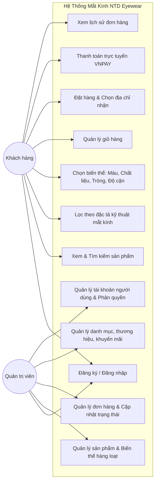
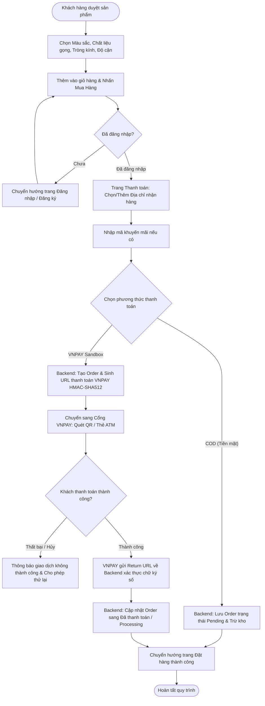
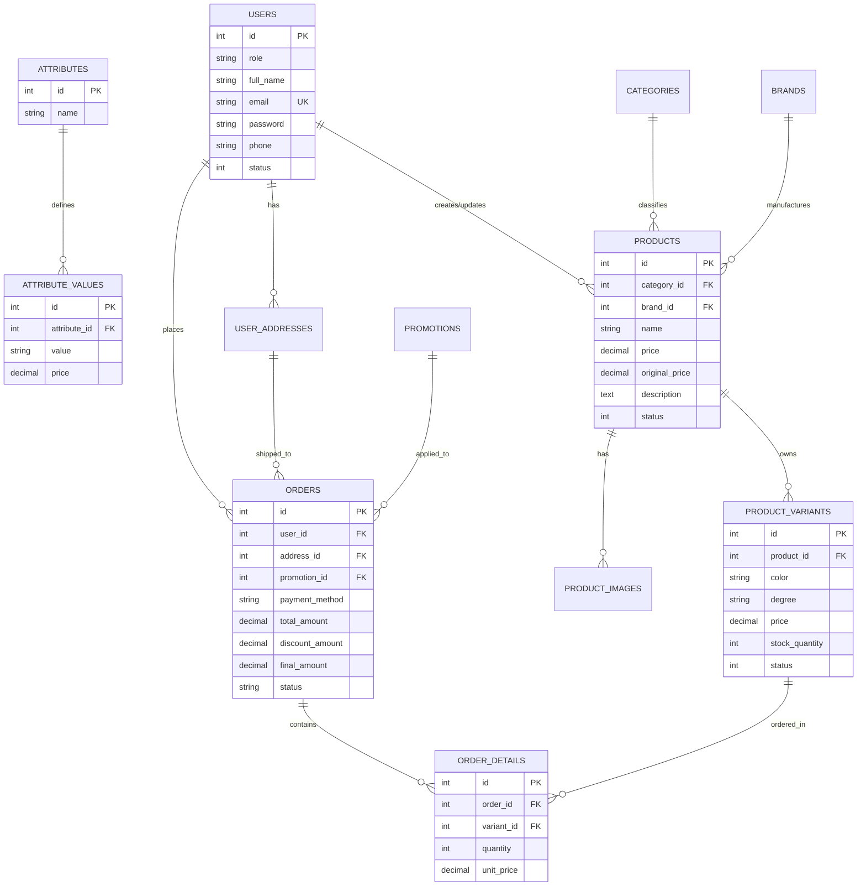

# BÁO CÁO ĐỒ ÁN MÔN LẬP TRÌNH JAVA

---

### **BỘ GIÁO DỤC VÀ ĐÀO TẠO**
### **TRƯỜNG ĐẠI HỌC ...**
### **KHOA CÔNG NGHỆ THÔNG TIN**

<br/><br/>

# BÁO CÁO ĐỒ ÁN MÔN HỌC: LẬP TRÌNH JAVA
## **ĐỀ TÀI: XÂY DỰNG HỆ THỐNG THƯƠNG MẠI ĐIỆN TỬ BÁN MẮT KÍNH TRỰC TUYẾN NTD EYEWEAR VỚI JAVA SPRING BOOT, SPRING DATA JPA VÀ NEXT.JS**

<br/><br/>

* **Học phần:** Lập trình Java (Java Web Application Development)
* **Giảng viên hướng dẫn:** [Điền tên Giảng viên hướng dẫn]
* **Sinh viên thực hiện:**
  1. **Nguyễn Tấn Điệp** – MSSV: **2123110145** (Trưởng nhóm - Backend & Full-stack)
  2. **[Thành viên 2 / Văn Trường]** – MSSV: **[Điền MSSV nếu có]**
* **Kho mã nguồn GitHub:** [https://github.com/TanDiep1004/TanDiepVanTruong_Java.git](https://github.com/TanDiep1004/TanDiepVanTruong_Java.git)
* **Thời gian thực hiện:** Năm học 2025 - 2026

<br/><br/>

---

## TRANG NHẬN XÉT CỦA GIẢNG VIÊN HƯỚNG DẪN

.........................................................................................................................................................  
.........................................................................................................................................................  
.........................................................................................................................................................  
.........................................................................................................................................................  
.........................................................................................................................................................  
.........................................................................................................................................................  
.........................................................................................................................................................  
.........................................................................................................................................................  

* **Điểm đánh giá bằng số:** ........................................
* **Điểm đánh giá bằng chữ:** ........................................
* **Chữ ký của Giảng viên:** ...........................................

---

## MỤC LỤC

1. [CHƯƠNG 1 – GIỚI THIỆU ĐỀ TÀI](#chương-1--giới-thiệu-đề-tài)
   - 1.1. Lý do chọn đề tài
   - 1.2. Mục tiêu và phạm vi
   - 1.3. Yêu cầu hệ thống (Chức năng & Phi chức năng)
   - 1.4. Công nghệ sử dụng và vai trò
2. [CHƯƠNG 2 – CƠ SỞ LÝ THUYẾT](#chương-2--cơ-sở-lý-thuyết)
   - 2.1. Framework Spring Boot
   - 2.2. Kiến trúc RESTful API
   - 2.3. Lưu trữ và truy vấn dữ liệu với Spring Data JPA & MySQL
   - 2.4. Cơ chế bảo mật Spring Security & JWT (JSON Web Token)
   - 2.5. Công nghệ bổ sung: Cổng thanh toán VNPAY & Frontend Next.js
3. [CHƯƠNG 3 – PHÂN TÍCH VÀ THIẾT KẾ HỆ THỐNG](#chương-3--phân-tích-và-thiết-kế-hệ-thống)
   - 3.1. Mô tả bài toán và các tác nhân sử dụng (Actors)
   - 3.2. Bảng chức năng theo tác nhân & Luồng xử lý nghiệp vụ chính
   - 3.3. Sơ đồ Use Case tổng quát và Sơ đồ hoạt động (Activity Diagram)
   - 3.4. Thiết kế cơ sở dữ liệu (Sơ đồ ERD & Chi tiết 17 bảng)
   - 3.5. Thiết kế giao diện và luồng tương tác người dùng
   - 3.6. Bảng danh sách Endpoint REST API
4. [CHƯƠNG 4 – CÀI ĐẶT VÀ TRIỂN KHAI HỆ THỐNG](#chương-4--cài-đặt-và-triển-khai-hệ-thống)
   - 4.1. Môi trường thực hiện và công cụ phát triển
   - 4.2. Cấu trúc mã nguồn dự án (Source Code Organization)
   - 4.3. Cài đặt các chức năng trọng tâm (Kèm mã nguồn tiêu biểu)
   - 4.4. Tích hợp cổng thanh toán trực tuyến VNPAY Sandbox
   - 4.5. Hướng dẫn cài đặt, cấu hình và khởi chạy hệ thống
5. [CHƯƠNG 5 – KIỂM THỬ HỆ THỐNG (TESTING)](#chương-5--kiểm-thử-hệ-thống-testing)
   - 5.1. Công cụ và phương pháp kiểm thử
   - 5.2. Bảng kịch bản kiểm thử (Test Cases) cho các nghiệp vụ chính
6. [CHƯƠNG 6 – KẾT QUẢ, ĐÁNH GIÁ VÀ HƯỚNG PHÁT TRIỂN](#chương-6--kết-quả-đánh-giá-và-hướng-phát-triển)
   - 6.1. Tổng hợp chức năng đã hoàn thành đối chiếu mục tiêu ban đầu
   - 6.2. Đánh giá chất lượng triển khai Java / Spring Boot
   - 6.3. Hạn chế hiện tại của hệ thống
   - 6.4. Hướng phát triển trong tương lai
7. [CHƯƠNG 7 – KẾT LUẬN VÀ PHỤ LỤC](#chương-7--kết-luận-và-phụ-lục)
   - 7.1. Kết luận và bài học rút ra
   - 7.2. Tài liệu tham khảo
   - 7.3. Bảng phân công nhiệm vụ nhóm
   - 7.4. Phụ lục: Tài khoản thử nghiệm & Hướng dẫn kiểm thử

---

## CHƯƠNG 1 – GIỚI THIỆU ĐỀ TÀI

### 1.1. Lý do chọn đề tài
Trong kỷ nguyên số hóa và thương mại điện tử bùng nổ, ngành bán lẻ phụ kiện thời trang và khúc xạ mắt kính tại Việt Nam đang có bước chuyển mình mạnh mẽ. Mắt kính không chỉ đơn thuần là công cụ hỗ trợ thị lực (kính cận, viễn, loạn thị) mà còn là phụ kiện thời trang khẳng định phong cách cá nhân và bảo vệ sức khỏe mắt (chống tia UV400, lọc ánh sáng xanh, chống lóa lái xe, tròng đổi màu khi ra nắng).

Tuy nhiên, đặc thù của mặt hàng mắt kính đòi hỏi cấu hình sản phẩm cực kỳ phức tạp: mỗi mẫu gọng kính thường đi kèm hàng loạt biến thể về **màu sắc gọng, chất liệu (Titanium, Acetate, Kim loại, Nhựa TR90), kiểu dáng gọng (Phi công, Mắt mèo, Vuông, Tròn), kích thước thông số quang học (chiều rộng tròng, cầu kính, càng kính)** và **độ cận / tính năng tròng kính**. Các hệ thống bán hàng truyền thống hoặc website đơn giản chưa đáp ứng được nhu cầu cá nhân hóa này, dẫn đến trải nghiệm đặt hàng thiếu chính xác.

Nhận thức được yêu cầu thực tế đó, nhóm đã quyết định chọn đề tài: **"Xây dựng hệ thống thương mại điện tử bán mắt kính trực tuyến NTD Eyewear"**. Đề tài tập trung áp dụng nền tảng **Java và Spring Boot** - framework tiêu chuẩn của doanh nghiệp thế giới - để xây dựng một Backend RESTful API vững chắc, kết hợp cùng hệ quản trị cơ sở dữ liệu **MySQL**, cơ chế bảo mật **Spring Security & JWT**, tích hợp cổng thanh toán trực tuyến quốc gia **VNPAY**, và giao diện **Next.js (React)** hiện đại.

### 1.2. Mục tiêu và phạm vi đề tài
* **Mục tiêu của đề tài:**
  1. Xây dựng hoàn chỉnh kiến trúc Client - Server tách biệt (Decoupled Architecture), chuẩn RESTful API bằng Java Spring Boot 3 và Next.js 14.
  2. Thiết kế và hiện thực cơ sở dữ liệu quan hệ tối ưu hóa cho ngành mắt kính với 17 bảng thực thể liên kết chặt chẽ.
  3. Cài đặt hệ thống bảo mật không trạng thái (Stateless Authentication) dựa trên JSON Web Token (JWT) và mã hóa mật khẩu một chiều BCrypt.
  4. Hiện thực hóa nghiệp vụ đặc thù: Bộ lọc kỹ thuật đa chiều, bộ chọn thông số gọng/tròng trực quan, tính phụ phí nâng cấp biến thể thời gian thực.
  5. Tích hợp thành công quy trình thanh toán trực tuyến qua cổng VNPAY Sandbox với thuật toán ký số bảo mật HMAC-SHA512.
  6. Xây dựng hệ thống bảng điều khiển quản trị (Admin Dashboard) chuyên nghiệp, hỗ trợ phân quyền người dùng và cập nhật trạng thái đơn hàng thời gian thực.
* **Phạm vi của hệ thống:**
  - **Phạm vi hoàn thành:** Phân hệ khách hàng (Xem sản phẩm, tìm kiếm, lọc đa thuộc tính, chọn biến thể, giỏ hàng, đặt hàng COD/VNPAY, quản lý sổ địa chỉ, lịch sử đơn hàng) và Phân hệ quản trị viên (Quản lý sản phẩm, biến thể hàng loạt, danh mục, thương hiệu, khuyến mãi, bài viết, banner, liên hệ, quản trị người dùng và quản lý đơn hàng).
  - **Giới hạn hệ thống:** Chưa kết nối API của đơn vị vận chuyển bên thứ ba (GHTK, Viettel Post); chưa xây dựng ứng dụng di động native (sử dụng giao diện Responsive Web tương thích tốt trên điện thoại).

### 1.3. Yêu cầu hệ thống
#### a. Yêu cầu chức năng
* **Quản lý xác thực & Người dùng:** Đăng ký, đăng nhập tài khoản khách hàng, đăng nhập tài khoản quản trị viên, xác thực JWT, phân quyền theo vai trò (`ROLE_USER`, `ROLE_ADMIN`).
* **Quản lý danh mục & Sản phẩm:** Thêm, sửa, xóa, tìm kiếm, phân trang; quản lý hình ảnh sản phẩm; quản lý biến thể đa thuộc tính mắt kính (màu sắc, độ cận, chất liệu, tính năng tròng).
* **Bộ lọc và Tìm kiếm:** Tìm kiếm theo từ khóa; lọc sản phẩm đa chiều theo Danh mục, Thương hiệu, Giới tính, Kiểu dáng gọng, Chất liệu, Tính năng bảo vệ và Khoảng giá.
* **Giỏ hàng & Đặt hàng:** Thêm sản phẩm cùng đầy đủ thông số tùy chọn vào giỏ hàng; chọn từng món để thanh toán (tương tự Shopee); áp dụng mã giảm giá; lưu trữ sổ địa chỉ giao hàng.
* **Thanh toán:** Hỗ trợ thanh toán khi nhận hàng (COD) và thanh toán trực tuyến quét mã QR/Thẻ ATM qua cổng **VNPAY Sandbox**.
* **Quản lý đơn hàng:** Khách hàng theo dõi trạng thái đơn hàng; Quản trị viên cập nhật trạng thái đơn hàng (Chờ xác nhận, Đang xử lý, Đang giao, Đã giao, Hủy đơn) và tự động ghi nhận nhân sự cập nhật.

#### b. Yêu cầu phi chức năng
* **Tính bảo mật:** Mật khẩu người dùng được băm an toàn bằng BCrypt (độ phức tạp 10 rounds). Các API quản trị và đơn hàng được bảo vệ nghiêm ngặt bằng JWT Filter; ngăn chặn tấn công giả mạo dữ liệu giao dịch VNPAY bằng thuật toán kiểm tra chữ ký số HMAC-SHA512.
* **Hiệu năng và Tính mở rộng:** Backend thiết kế phi trạng thái (Stateless); sử dụng Spring Data JPA Repository kết hợp Hibernate Lazy/Eager Loading hợp lý để tối ưu số lượng truy vấn SQL.
* **Tính toàn vẹn dữ liệu:** Thiết lập đầy đủ ràng buộc khóa ngoại (Foreign Keys), quy tắc cascade và xử lý giao dịch `@Transactional` đảm bảo tính nguyên tử (Atomicity) khi tạo đơn hàng và trừ tồn kho.
* **Giao diện người dùng (UI/UX):** Tương thích responsive trên máy tính và thiết bị di động, tốc độ tải trang nhanh, thông báo Toast thông minh, hỗ trợ chuyển đổi giao diện Sáng/Tối (Light/Dark mode) và đa ngôn ngữ.

### 1.4. Công nghệ sử dụng và vai trò trong hệ thống

#### **Bảng 4.1: Bảng công nghệ sử dụng trong đồ án**
| Nhóm công nghệ | Công nghệ cụ thể | Phiên bản | Vai trò trong hệ thống |
| :--- | :--- | :--- | :--- |
| **Ngôn ngữ & Backend** | Java / JDK | OpenJDK 17 LTS | Ngôn ngữ lập trình chính phía server, hỗ trợ cú pháp hiện đại, tối ưu bộ nhớ và đa luồng |
| | Spring Boot | 3.4.2 | Framework xương sống: Quản lý Bean (IoC/DI), cấu hình tự động, xây dựng RESTful API |
| | Spring Security | 6.x | Xây dựng bộ lọc bảo mật Filter Chain, mã hóa mật khẩu BCrypt, phân quyền truy cập endpoint |
| | JJWT (io.jsonwebtoken) | 0.12.6 | Tạo, ký số và xác thực JSON Web Token trong mỗi yêu cầu gửi lên từ Client |
| | Lombok | 1.18.x | Tự động tạo Getter, Setter, Builder, Constructor giúp mã nguồn Java ngắn gọn, sạch sẽ |
| **Cơ sở dữ liệu** | MySQL Server | 8.0 (XAMPP) | Hệ quản trị cơ sở dữ liệu quan hệ, lưu trữ an toàn toàn bộ dữ liệu nghiệp vụ của hệ thống |
| | Spring Data JPA / Hibernate | 3.4.2 / 6.x | Công nghệ ORM: Ánh xạ bảng CSDL thành Java Entity Class, tự động sinh các câu lệnh truy vấn |
| **Giao diện (Frontend)** | Next.js (React) | 14.x | Xây dựng giao diện Single Page Application hiện đại với Server/Client Components |
| | Tailwind CSS | 3.4.x | Thiết kế kiểu dáng giao diện theo Utility-First, đồng bộ màu sắc và hiệu ứng chuyển động |
| | Axios | 1.7.x | HTTP Client gửi request đến Spring Boot API, tự động đính kèm JWT Bearer Token |
| | Lucide React | 0.4.x | Bộ biểu tượng đồ họa vector cao cấp cho ngành mắt kính và thương mại điện tử |
| **Dịch vụ tích hợp** | VNPAY Sandbox | v2.1.0 | Cổng thanh toán trực tuyến: sinh mã URL thanh toán QR code, xác minh chữ ký số SHA512 |
| **Công cụ & Kiểm thử** | Gradle Wrapper | 8.11 | Công cụ tự động hóa biên dịch, quản lý thư viện phụ thuộc của dự án Java |
| | Postman | 10.x | Công cụ kiểm thử trực tiếp các REST API endpoint (GET, POST, PUT, DELETE) |
| | JUnit 5 | 5.10.x | Thư viện kiểm thử đơn vị và tích hợp trong Spring Boot |
| | Git & GitHub | 2.x | Quản lý phiên bản mã nguồn phân tán và cộng tác nhóm |

---

## CHƯƠNG 2 – CƠ SỞ LÝ THUYẾT

### 2.1. Framework Spring Boot
Spring Boot là framework mã nguồn mở xây dựng trên nền tảng Spring Framework kinh điển của Java, được thiết kế nhằm tinh giản tối đa quá trình khởi tạo, cấu hình và triển khai ứng dụng cấp doanh nghiệp.
* **Nguyên lý Đảo ngược điều khiển (Inversion of Control - IoC) và Tiêm phụ thuộc (Dependency Injection - DI):** Thay vì lập trình viên phải tự khởi tạo đối tượng bằng từ khóa `new`, Spring IoC Container chịu trách nhiệm quản lý vòng đời của các Bean và tự động tiêm các phụ thuộc thông qua các annotation `@Service`, `@Repository`, `@RestController`, `@Autowired` hoặc Constructor Injection (kết hợp `@RequiredArgsConstructor` của Lombok).
* **Cấu hình tự động (Auto-configuration):** Spring Boot tự động nhận diện các thư viện có trong classpath (ví dụ: `spring-boot-starter-data-jpa`, `mysql-connector-j`) để tự động cấu hình DataSource, EntityManagerFactory và TransactionManager mà không cần viết file XML phức tạp.
* **Embedded Servlet Container:** Tích hợp sẵn máy chủ Tomcat nội tại, cho phép đóng gói ứng dụng thành một tệp JAR độc lập duy nhất có thể chạy trực tiếp bằng lệnh `java -jar`.

### 2.2. Kiến trúc RESTful API
REST (Representational State Transfer) là kiểu kiến trúc phần mềm chuẩn mực cho các hệ thống phân tán:
* **Tính không trạng thái (Statelessness):** Mỗi yêu cầu HTTP gửi từ Client lên Server phải chứa đầy đủ thông tin để Server hiểu và xử lý, Server không lưu trữ phiên làm việc (Session) của người dùng trong bộ nhớ RAM.
* **Các phương thức HTTP tiêu chuẩn:**
  - `GET`: Truy vấn và đọc dữ liệu (không làm thay đổi trạng thái server).
  - `POST`: Tạo mới tài nguyên (sản phẩm, đơn hàng, người dùng).
  - `PUT`: Cập nhật toàn bộ thông tin của tài nguyên đã tồn tại.
  - `DELETE`: Xóa tài nguyên khỏi hệ thống hoặc cập nhật trạng thái xóa mềm.
* **Mã trạng thái HTTP (HTTP Status Codes):** Sử dụng các mã chuẩn quốc tế như `200 OK`, `201 Created`, `400 Bad Request`, `401 Unauthorized`, `403 Forbidden`, `404 Not Found`, `500 Internal Server Error`.
* **Định dạng dữ liệu JSON:** Mọi dữ liệu trao đổi giữa Spring Boot và Next.js đều được chuẩn hóa dưới dạng JSON qua lớp DTO chung `ApiResponse<T>`.

### 2.3. Lưu trữ và truy vấn dữ liệu với Spring Data JPA & MySQL
* **Object-Relational Mapping (ORM) với Hibernate:** Hibernate đóng vai trò cầu nối ánh xạ các lớp đối tượng Java (`@Entity`) thành các bảng quan hệ trong MySQL. Các mối quan hệ kinh điển được thể hiện rõ:
  - `@ManyToOne`: Nhiều sản phẩm thuộc về một danh mục hoặc thương hiệu.
  - `@OneToMany`: Một đơn hàng chứa nhiều chi tiết đơn hàng (`OrderDetail`).
  - `@ManyToMany`: Quan hệ giữa chương trình khuyến mãi và sản phẩm áp dụng (`PromotionProduct`).
* **Spring Data JPA Repositories:** Cung cấp sẵn các interface mạnh mẽ kế thừa `JpaRepository<T, ID>`, cho phép sử dụng ngay các phương thức CRUD (`save`, `findById`, `findAll`, `deleteById`) và hỗ trợ tính năng **Query Methods** tự động sinh câu lệnh SQL chuẩn xác dựa trên tên hàm Java (Ví dụ: `findByStatusOrderByIdDesc(Integer status)`, `findByEmail(String email)`).
* **JPA Auditing:** Hệ thống tự động ghi nhận thời gian tạo (`@CreationTimestamp`), thời gian cập nhật (`@UpdateTimestamp`) và người thao tác (`@CreatedBy`, `@LastModifiedBy`) thông qua `AuditorAwareImpl`.

### 2.4. Cơ chế bảo mật Spring Security & JWT (JSON Web Token)
* **Kiến trúc Security Filter Chain:** Spring Security 6 quản lý quyền truy cập thông qua chuỗi các bộ lọc HTTP (Filter Chain). Hệ thống cấu hình phân tầng quyền truy cập:
  - Cho phép truy cập công khai (Permit All): Các API xem sản phẩm, danh mục, bài viết, banner, đăng ký, đăng nhập (`/api/public/**`, `/api/auth/**`).
  - Yêu cầu xác thực tài khoản khách hàng: Các API xem giỏ hàng, thông tin cá nhân, tạo đơn hàng (`/api/customer/**`).
  - Yêu cầu quyền quản trị viên: Toàn bộ API quản trị hệ thống (`/api/admin/**`) chỉ cho phép tài khoản có quyền `ROLE_ADMIN`.
* **Cơ chế xác thực bằng JWT:**
  - Khi người dùng đăng nhập thành công, Server tạo ra một chuỗi JWT gồm 3 phần: Header, Payload (chứa username, role, thời hạn) và Signature (được ký bằng khóa bí mật HMAC-SHA256).
  - Ở mỗi yêu cầu tiếp theo, Client đính kèm chuỗi này vào tiêu đề `Authorization: Bearer <token>`. Lớp `JwtAuthenticationFilter` chặn request, giải mã token, nạp thông tin quyền hạn vào `SecurityContextHolder`.
* **Mã hóa mật khẩu BCrypt:** Áp dụng thuật toán băm một chiều BCrypt kết hợp salt ngẫu nhiên, đảm bảo nếu cơ sở dữ liệu bị lộ, mật khẩu gốc của người dùng vẫn được bảo vệ tuyệt đối.

### 2.5. Công nghệ bổ sung: Cổng thanh toán VNPAY & Frontend Next.js
* **Cổng thanh toán điện tử VNPAY Sandbox:** Giải pháp cổng thanh toán hàng đầu tại Việt Nam cho phép khách hàng thanh toán qua Mobile Banking (VNPAY-QR), thẻ ATM nội địa hoặc thẻ quốc tế (Visa/Mastercard). Giao thức giao tiếp giữa Spring Boot và VNPAY sử dụng thuật toán ký số băm dữ liệu `HMAC-SHA512` bảo đảm tính toàn vẹn và chống chối bỏ.
* **Next.js 14 App Router:** Tối ưu hóa hiệu năng render phía client và server, hỗ trợ cơ chế định tuyến linh hoạt theo thư mục, dễ dàng tích hợp Tailwind CSS và quản lý trạng thái giỏ hàng qua React Context API.

---

## CHƯƠNG 3 – PHÂN TÍCH VÀ THIẾT KẾ HỆ THỐNG

### 3.1. Mô tả bài toán và các tác nhân sử dụng (Actors)
Hệ thống **NTD Eyewear** phục vụ nhu cầu kinh doanh mắt kính trực tuyến, kết nối giữa khách hàng mua sắm và đội ngũ quản lý cửa hàng. Hệ thống xác định 3 tác nhân chính:
1. **Khách hàng vãng lai (Guest):** Người dùng chưa đăng nhập, có quyền truy cập trang chủ, tìm kiếm kính, xem thông số đặc tả kỹ thuật, lọc sản phẩm theo nhiều tiêu chí.
2. **Khách hàng thành viên (Customer):** Người dùng đã đăng ký/đăng nhập tài khoản, có quyền quản lý sổ địa chỉ giao hàng, lưu giỏ hàng, chọn biến thể, áp dụng mã giảm giá, đặt hàng COD hoặc thanh toán online VNPAY, theo dõi lịch sử đơn hàng.
3. **Quản trị viên (Admin):** Nhân sự cấp cao chịu trách nhiệm quản lý toàn bộ cơ sở dữ liệu: Sản phẩm, Thuộc tính đặc tả mắt kính, Danh mục, Thương hiệu, Đơn hàng, Người dùng, Khuyến mãi, Bài viết, Banner và Cài đặt cửa hàng.

### 3.2. Bảng chức năng theo tác nhân & Luồng xử lý nghiệp vụ chính

#### **Bảng 4.2: Bảng chức năng theo tác nhân**
| Tác nhân (Actor) | Tên chức năng | Mô tả tóm tắt nghiệp vụ | Trạng thái thực tế |
| :--- | :--- | :--- | :--- |
| **Khách hàng vãng lai** | Xem danh mục & Sản phẩm | Xem danh sách kính thời trang, kính râm, kính cận theo phân trang | **Đã hoàn thành** |
| | Tìm kiếm & Lọc đa chiều | Lọc theo Giới tính, Kiểu gọng, Chất liệu, Tính năng tròng và Khoảng giá | **Đã hoàn thành** |
| | Xem chi tiết sản phẩm | Xem ảnh mẫu xoay góc, bảng đặc tả kỹ thuật tiêu chuẩn quốc tế | **Đã hoàn thành** |
| | Đăng ký & Đăng nhập | Tạo tài khoản mới bằng Email, mật khẩu được mã hóa an toàn | **Đã hoàn thành** |
| **Khách hàng thành viên** | Quản lý sổ địa chỉ | Thêm, sửa, xóa các địa chỉ giao hàng và thiết lập địa chỉ mặc định | **Đã hoàn thành** |
| | Chọn cấu hình biến thể | Chọn trực quan: Màu sắc, Chất liệu gọng, Kiểu dáng, Size, Tính năng, Độ cận | **Đã hoàn thành** |
| | Giỏ hàng Shopee-style | Xem giỏ hàng, chọn từng món thanh toán, tự động lưu theo người dùng | **Đã hoàn thành** |
| | Đặt hàng COD | Tạo đơn hàng thanh toán tiền mặt khi nhận hàng, trừ tồn kho | **Đã hoàn thành** |
| | Thanh toán VNPAY | Chuyển hướng đến cổng VNPAY quét mã QR, tự động cập nhật trạng thái | **Đã hoàn thành** |
| | Lịch sử mua hàng | Xem lại chi tiết đơn hàng đã đặt, ngày đặt và trạng thái vận chuyển | **Đã hoàn thành** |
| **Quản trị viên (Admin)** | Quản lý sản phẩm | Thêm, sửa, xóa, tìm kiếm, phân trang và tải ảnh kính lên server | **Đã hoàn thành** |
| | Quản lý thuộc tính biến thể | Thiết lập 16 nhóm đặc tả kỹ thuật và gán biến thể hàng loạt cho toàn bộ kho | **Đã hoàn thành** |
| | Quản lý đơn hàng | Xem danh sách đơn, lọc theo trạng thái, phê duyệt/chuyển trạng thái đơn | **Đã hoàn thành** |
| | Quản lý danh mục & Hiệu | Phân loại kính nam/nữ/trẻ em, quản lý thương hiệu (Ray-Ban, Gucci...) | **Đã hoàn thành** |
| | Quản lý khuyến mãi | Tạo mã giảm giá theo % hoặc tiền mặt, giới hạn ngày áp dụng | **Đã hoàn thành** |
| | Quản lý người dùng | Xem danh sách khách hàng, khóa/mở tài khoản, phân quyền quản trị | **Đã hoàn thành** |
| | Báo cáo & Thống kê | Thống kê tổng doanh thu, số lượng đơn hàng, số lượng kính đang bán | **Đã hoàn thành** |

### 3.3. Sơ đồ Use Case tổng quát và Sơ đồ hoạt động (Activity Diagram)

#### a. Sơ đồ Use Case tổng quát hệ thống


#### b. Sơ đồ hoạt động (Activity Diagram): Quy trình Đặt hàng & Thanh toán VNPAY


### 3.4. Thiết kế cơ sở dữ liệu (Sơ đồ ERD & Chi tiết bảng)

#### a. Sơ đồ quan hệ thực thể (ERD)


#### b. Chi tiết các bảng dữ liệu cốt lõi trong cơ sở dữ liệu `matkinh_db`

#### **Bảng 4.3: Bảng thiết kế cơ sở dữ liệu**
| Bảng / Entity | Khóa chính (PK) | Khóa ngoại (FK) & Quan hệ | Vai trò & Mục đích lưu trữ |
| :--- | :--- | :--- | :--- |
| `users` | `id` (INT, AI) | Không | Lưu trữ thông tin tài khoản người dùng, email, mật khẩu băm BCrypt, số điện thoại và vai trò (`ROLE_ADMIN`, `ROLE_USER`) |
| `user_addresses` | `id` (INT, AI) | `user_id` -> `users(id)` (N-1) | Lưu danh bạ sổ địa chỉ giao hàng của từng khách hàng (Họ tên, SĐT, số nhà, phường xã, quận huyện, tỉnh thành, địa chỉ mặc định) |
| `categories` | `id` (INT, AI) | `parent_id` -> `categories(id)` (N-1) | Phân loại sản phẩm mắt kính (Kính mát, Kính cận nam, Kính nữ, Kính trẻ em, Phụ kiện) |
| `brands` | `id` (INT, AI) | Không | Lưu thông tin các hãng sản xuất mắt kính nổi tiếng (Ray-Ban, Gucci, Oakley, Gentle Monster...) |
| `products` | `id` (INT, AI) | `category_id` -> `categories(id)`<br/>`brand_id` -> `brands(id)` | Lưu thông tin sản phẩm chính: tên kính, giá bán, giá gốc, mô tả chi tiết, chất liệu gọng, kiểu dáng và trạng thái hiển thị |
| `product_images` | `id` (INT, AI) | `product_id` -> `products(id)` (N-1) | Lưu danh sách đường dẫn ảnh chụp các góc độ mẫu kính (mẫu 1, mẫu 2, mẫu xoay góc...) |
| `product_variants`| `id` (INT, AI) | `product_id` -> `products(id)` (N-1) | Lưu các biến thể mua sắm thực tế của mẫu kính (kết hợp màu sắc gọng, độ cận, đơn giá biến thể và số lượng tồn kho) |
| `attributes` | `id` (INT, AI) | Không | Danh mục 16 nhóm đặc tả kỹ thuật mắt kính (Màu sắc, Chất liệu gọng, Kiểu dáng, Kích thước tròng, Chiều dài càng kính, Trọng lượng, Chống UV400, Ánh sáng xanh, Tròng đổi màu...) |
| `attribute_values`| `id` (INT, AI) | `attribute_id` -> `attributes(id)` | Lưu các giá trị cụ thể của từng thuộc tính kèm phụ phí nâng cấp tương ứng (VD: Titanium +500.000đ, Tròng đổi màu +650.000đ) |
| `orders` | `id` (INT, AI) | `user_id` -> `users(id)`<br/>`address_id` -> `user_addresses(id)`<br/>`promotion_id` -> `promotions(id)` | Quản lý đơn đặt hàng: phương thức thanh toán (`COD`, `VNPAY`), tổng tiền, tiền giảm giá, tiền thanh toán cuối cùng, trạng thái đơn hàng (`Pending`, `Processing`, `Shipping`, `Delivered`, `Cancelled`) |
| `order_details` | `id` (INT, AI) | `order_id` -> `orders(id)`<br/>`variant_id` -> `product_variants(id)` | Lưu chi tiết từng sản phẩm kính trong đơn hàng: biến thể đã chọn, số lượng mua, đơn giá tại thời điểm đặt |
| `promotions` | `id` (INT, AI) | Không | Lưu mã giảm giá khuyến mãi (Coupon voucher), tỷ lệ giảm, mức giảm tối đa, ngày bắt đầu và kết thúc |
| `articles` | `id` (INT, AI) | `created_by` -> `users(id)` | Lưu trữ các bài viết tin tức, cẩm nang chăm sóc mắt, kiến thức bảo quản kính |
| `banners` | `id` (INT, AI) | Không | Quản lý banner quảng cáo, sự kiện khuyến mãi hiển thị tại Slider trang chủ |
| `contacts` | `id` (INT, AI) | Không | Lưu thông tin phản hồi, khiếu nại, câu hỏi gửi từ khách hàng vãng lai |
| `settings` | `id` (INT, AI) | Không | Lưu cấu hình hệ thống: hotline, email hỗ trợ, địa chỉ cửa hàng, chính sách bảo hành |

### 3.5. Thiết kế giao diện và luồng tương tác người dùng
Hệ thống được thiết kế theo tư duy lấy người dùng làm trung tâm (User-Centered Design):
1. **Trang chủ (`/`):** Hero Banner động giới thiệu bộ sưu tập kính mới nhất, khu vực danh mục nổi bật, khối sản phẩm khuyến mãi HOT kèm đồng hồ đếm ngược và thanh cam kết 100% chính hãng.
2. **Trang danh mục & Bộ lọc đa chiều (`/products`):** Thanh bên trái (Sidebar Filter) tích hợp bộ lọc đặc tả kỹ thuật mắt kính: Giới tính (Nam, Nữ, Unisex), Kiểu dáng gọng (Phi công, Vuông, Mắt mèo), Chất liệu (Titanium, Acetate, Kim loại), Tính năng bảo vệ (UV400, Ánh sáng xanh, Đổi màu). Khi người dùng chọn tiêu chí, danh sách sản phẩm bên phải tự động cập nhật mà không cần tải lại trang.
3. **Trang chi tiết sản phẩm (`/products/[id]`):** 
   - Cột trái: Thư viện hình ảnh lớn kèm thumbnail góc chụp đa chiều cho phép chuyển đổi ảnh mượt mà.
   - Cột phải: **Bộ nút chọn tùy chọn đặc tả kính trực quan (Interactive Option Pills)** gồm Màu sắc, Chất liệu gọng, Kiểu dáng, Kích thước thông số, Tính năng bảo vệ tròng và Tùy chọn độ cận. Nút đang kích hoạt nổi bật với nền đen viền đậm; giá tiền tự động cộng dồn phụ phí nâng cấp theo thời gian thực.
4. **Trang giỏ hàng (`/cart`):** Bố cục phong cách Shopee, cho phép tích chọn checkbox từng sản phẩm muốn thanh toán, tăng giảm số lượng, tự động tính tổng tiền các món được chọn.
5. **Trang thanh toán (`/checkout`):** Khách hàng chọn địa chỉ từ sổ địa chỉ có sẵn hoặc nhập địa chỉ mới; lựa chọn phương thức thanh toán **COD** hoặc **Cổng VNPAY Sandbox**.
6. **Trang quản trị Admin (`/admin`):** Dashboard thống kê tổng quan; bảng quản lý sản phẩm với bộ lọc thông minh; bảng gán biến thể hàng loạt cho toàn bộ sản phẩm cửa hàng chỉ bằng một cú nhấp chuột; bảng quản lý đơn hàng với thao tác đổi trạng thái tức thì.

### 3.6. Bảng danh sách Endpoint REST API

#### **Bảng 4.4: Bảng API xử lý của hệ thống**
| HTTP Method | Endpoint URL | Chức năng nghiệp vụ | Dữ liệu đầu vào (Request) | Dữ liệu đầu ra (Response) | Quyền truy cập |
| :--- | :--- | :--- | :--- | :--- | :--- |
| `POST` | `/api/auth/register` | Đăng ký tài khoản khách hàng mới | JSON: `fullName, email, password, phone` | JSON: `UserDto, message` | Công khai |
| `POST` | `/api/auth/login` | Đăng nhập tài khoản & Nhận JWT | JSON: `email, password` | JSON: `token, role, user` | Công khai |
| `GET` | `/api/public/products` | Lấy danh sách kính đang mở bán | Query params: `page, size, keyword` | JSON: `List<Product>` | Công khai |
| `GET` | `/api/public/products/{id}`| Lấy chi tiết kính kèm ảnh & biến thể | Path variable: `id` | JSON: `ProductDetailResponse` | Công khai |
| `GET` | `/api/attributes` | Lấy danh sách 16 nhóm thuộc tính kỹ thuật | Không | JSON: `List<AttributeDto>` | Công khai |
| `POST` | `/api/public/payment/create-vnpay` | Tạo giao dịch & Link thanh toán VNPAY | Query: `orderId, amount` | JSON: `paymentUrl, orderId` | Công khai |
| `GET` | `/api/public/payment/vnpay-callback` | Xử lý phản hồi kết quả từ VNPAY | Query: Các tham số mã hóa của VNPAY | JSON: `isSuccess, orderId` | Công khai |
| `GET` | `/api/customer/profile` | Xem thông tin cá nhân khách hàng | Header: `Authorization Bearer <JWT>` | JSON: `UserProfileDto` | Khách hàng |
| `GET` | `/api/customer/addresses` | Lấy danh sách sổ địa chỉ của khách | Header: `Authorization Bearer <JWT>` | JSON: `List<UserAddress>` | Khách hàng |
| `POST` | `/api/customer/addresses` | Thêm mới địa chỉ nhận hàng | JSON: `receiverName, phone, address...` | JSON: `UserAddress` | Khách hàng |
| `POST` | `/api/customer/orders` | Đặt hàng mới (COD hoặc VNPAY) | JSON: `OrderRequest (items, addressId)` | JSON: `OrderResponse` | Khách hàng |
| `GET` | `/api/customer/orders` | Xem lịch sử đơn hàng của tôi | Header: `Authorization Bearer <JWT>` | JSON: `List<Order>` | Khách hàng |
| `GET` | `/api/admin/products` | Lấy danh sách sản phẩm quản trị | Query params: lọc danh mục, hiệu, giá | JSON: `List<Product>` | Quản trị viên |
| `POST` | `/api/admin/products` | Thêm mới sản phẩm kính vào kho | JSON: `ProductRequest` | JSON: `Product` | Quản trị viên |
| `PUT` | `/api/admin/products/{id}` | Cập nhật thông tin sản phẩm | Path variable: `id`, JSON body | JSON: `Product` | Quản trị viên |
| `DELETE` | `/api/admin/products/{id}` | Xóa kính khỏi hệ thống | Path variable: `id` | JSON: `ApiResponse` | Quản trị viên |
| `POST` | `/api/admin/products/apply-all-variants` | Gán biến thể màu/độ hàng loạt cho toàn kho | JSON: `List<VariantDto>` | JSON: Số lượng sản phẩm cập nhật | Quản trị viên |
| `GET` | `/api/admin/orders` | Xem danh sách tất cả đơn hàng | Query params: lọc theo trạng thái | JSON: `List<Order>` | Quản trị viên |
| `PUT` | `/api/admin/orders/{id}/status` | Duyệt / Đổi trạng thái đơn hàng | Path: `id`, Query: `status` | JSON: `Order` | Quản trị viên |
| `GET` | `/api/admin/users` | Quản trị danh sách người dùng | Query params: `page, keyword` | JSON: `List<User>` | Quản trị viên |

---

## CHƯƠNG 4 – CÀI ĐẶT VÀ TRIỂN KHAI HỆ THỐNG

### 4.1. Môi trường thực hiện và công cụ phát triển
* **Hệ điều hành:** Microsoft Windows 11 64-bit.
* **Môi trường Java:** OpenJDK 17 LTS (Java HotSpot 64-Bit Server VM).
* **Môi trường Node:** Node.js v18+ và trình quản lý gói npm v10+.
* **Công cụ xây dựng (Build Tool):** Gradle 8.11 (sử dụng Gradle Wrapper `gradlew.bat`).
* **Hệ quản trị CSDL:** MySQL Community Server 8.0 chạy trên nền XAMPP Control Panel v3.3.
* **Môi trường phát triển tích hợp (IDE):** Visual Studio Code kết hợp Extension Pack for Java / IntelliJ IDEA 2024.
* **Trình duyệt kiểm thử:** Google Chrome v130+, Microsoft Edge.

### 4.2. Cấu trúc mã nguồn dự án (Source Code Organization)
Dự án được cấu trúc theo mô hình **Monorepo** phân định rõ ranh giới giữa Backend và Frontend:

```text
NGUYENTANDIEP_2123110145/
├── backend/                               # Mã nguồn Server Java Spring Boot
│   ├── build.gradle                       # Cấu hình dependencies & plugin Gradle
│   ├── gradlew / gradlew.bat              # Script thực thi Gradle Wrapper
│   └── src/
│       ├── main/
│       │   ├── java/com/example/backend/
│       │   │   ├── BackendApplication.java # Lớp kích hoạt ứng dụng Spring Boot
│       │   │   ├── config/                # Cấu hình CORS, JPA Auditing, VNPay
│       │   │   ├── controller/            # Tầng Controller tiếp nhận HTTP Request
│       │   │   │   ├── AuthController.java
│       │   │   │   ├── PublicProductController.java
│       │   │   │   ├── AdminProductController.java
│       │   │   │   ├── CustomerOrderController.java
│       │   │   │   ├── AdminOrderController.java
│       │   │   │   ├── PaymentController.java   # Xử lý thanh toán VNPAY
│       │   │   │   └── AttributeController.java # Quản lý đặc tả kỹ thuật
│       │   │   ├── dto/                   # Data Transfer Objects (Request/Response)
│       │   │   ├── entity/                # Các lớp thực thể ánh xạ JPA Entity
│       │   │   │   ├── Product.java, ProductVariant.java, Order.java...
│       │   │   ├── repository/            # Tầng Repository thao tác CSDL MySQL
│       │   │   ├── security/              # Tầng bảo mật Spring Security & JWT
│       │   │   │   ├── SecurityConfig.java
│       │   │   │   ├── JwtTokenProvider.java
│       │   │   │   └── JwtAuthenticationFilter.java
│       │   │   └── service/               # Tầng Service xử lý logic nghiệp vụ
│       │   │       ├── impl/OrderServiceImpl.java
│       │   │       └── impl/ProductServiceImpl.java
│       │   └── resources/
│       │       └── application.properties # Cấu hình cổng 8085, MySQL, JWT Secret
│       └── test/                          # Mã nguồn kiểm thử JUnit 5
│
└── frontend/                              # Mã nguồn Client Next.js 14 (App Router)
    ├── package.json                       # Cấu hình thư viện Next.js, React, Tailwind
    ├── tailwind.config.js                 # Cấu hình màu sắc, layout giao diện
    ├── axiosCustom.js                     # HTTP Client tự động gắn JWT Bearer Token
    ├── context/                           # React Context API (CartContext, ToastContext)
    └── app/                               # Các trang màn hình giao diện
        ├── (site)/                        # Phân hệ mua sắm của Khách hàng
        │   ├── page.js                    # Trang chủ cửa hàng
        │   ├── products/page.js           # Trang danh sách kính & Bộ lọc đa chiều
        │   ├── products/[id]/page.js      # Chi tiết kính & Bộ chọn thông số biến thể
        │   ├── cart/page.js               # Giỏ hàng Shopee-style
        │   ├── checkout/page.js           # Trang thanh toán COD & VNPAY
        │   └── vnpay-return/page.js       # Trang tiếp nhận kết quả thanh toán VNPAY
        └── (admin)/admin/                 # Phân hệ Quản trị cửa hàng
            ├── products/page.js           # Quản lý danh sách sản phẩm & Bộ lọc admin
            ├── attributes/page.js         # Quản lý 16 nhóm thuộc tính kỹ thuật mắt kính
            └── orders/page.js             # Quản lý đơn hàng & Phê duyệt trạng thái
```

### 4.3. Cài đặt các chức năng trọng tâm (Kèm mã nguồn tiêu biểu)

#### a. Cấu hình bảo mật phân quyền Stateless với Spring Security & JWT
Đoạn mã sau trong `SecurityConfig.java` thể hiện cách tổ chức chuỗi lọc bảo mật:
```java
@Configuration
@EnableWebSecurity
@RequiredArgsConstructor
public class SecurityConfig {

    private final JwtAuthenticationFilter jwtAuthenticationFilter;

    @Bean
    public SecurityFilterChain securityFilterChain(HttpSecurity http) throws Exception {
        http
            .csrf(AbstractHttpConfigurer::disable)
            .cors(Customizer.withDefaults())
            .sessionManagement(session -> session.sessionCreationPolicy(SessionCreationPolicy.STATELESS))
            .authorizeHttpRequests(auth -> auth
                .requestMatchers("/api/auth/**", "/api/public/**").permitAll()
                .requestMatchers("/api/customer/**").authenticated()
                .requestMatchers("/api/admin/**").hasRole("ADMIN")
                .anyRequest().authenticated()
            )
            .addFilterBefore(jwtAuthenticationFilter, UsernamePasswordAuthenticationFilter.class);

        return http.build();
    }

    @Bean
    public PasswordEncoder passwordEncoder() {
        return new BCryptPasswordEncoder();
    }
}
```
*Giải thích:* Ứng dụng tắt CSRF vì chạy mô hình RESTful API Stateless hoàn toàn bằng JWT; mở quyền truy cập tự do cho các đường dẫn public; chỉ những request có kèm theo JWT hợp lệ với quyền `ROLE_ADMIN` mới được phép thao tác vào các đường dẫn `/api/admin/**`.

#### b. Xử lý nghiệp vụ đặt hàng và trừ kho giao dịch nguyên tử (`OrderServiceImpl.java`)
```java
@Service
@RequiredArgsConstructor
public class OrderServiceImpl implements OrderService {

    private final OrderRepository orderRepository;
    private final ProductVariantRepository variantRepository;

    @Override
    @Transactional
    public Order createOrder(User user, OrderRequest request) {
        Order order = new Order();
        order.setUser(user);
        order.setPaymentMethod(request.getPaymentMethod());
        order.setStatus("Pending");

        List<OrderDetail> details = new ArrayList<>();
        BigDecimal total = BigDecimal.ZERO;

        for (OrderItemRequest item : request.getItems()) {
            ProductVariant variant = variantRepository.findById(item.getVariantId())
                .orElseThrow(() -> new RuntimeException("Biến thể kính không tồn tại"));

            if (variant.getStockQuantity() < item.getQuantity()) {
                throw new RuntimeException("Sản phẩm " + variant.getColor() + " đã hết hàng trong kho!");
            }

            // Trừ số lượng tồn kho ngay khi đặt hàng thành công
            variant.setStockQuantity(variant.getStockQuantity() - item.getQuantity());
            variantRepository.save(variant);

            OrderDetail detail = new OrderDetail();
            detail.setOrder(order);
            detail.setVariant(variant);
            detail.setQuantity(item.getQuantity());
            detail.setUnitPrice(variant.getPrice());
            details.add(detail);

            total = total.add(variant.getPrice().multiply(BigDecimal.valueOf(item.getQuantity())));
        }

        order.setTotalAmount(total);
        order.setFinalAmount(total.subtract(order.getDiscountAmount()));
        order.setOrderDetails(details);

        return orderRepository.save(order);
    }
}
```
*Giải thích:* Annotation `@Transactional` đảm bảo nếu bất kỳ sản phẩm nào không đủ tồn kho hoặc xảy ra lỗi mạng ở bước lưu, toàn bộ quá trình sẽ được Rollback, tránh tình trạng dữ liệu mồ côi hoặc sai lệch số lượng tồn kho.

### 4.4. Tích hợp cổng thanh toán trực tuyến VNPAY Sandbox
* **Lý do lựa chọn VNPAY:** VNPAY là cổng thanh toán điện tử phổ biến nhất tại Việt Nam, hỗ trợ mạng lưới hơn 40 ngân hàng nội địa và ví điện tử, môi trường Sandbox thử nghiệm ổn định, tài liệu API rõ ràng.
* **Luồng tích hợp:**
  1. Khi người dùng chọn hình thức thanh toán VNPAY và nhấn xác nhận, Frontend gọi API `POST /api/public/payment/create-vnpay?orderId=...&amount=...`.
  2. Phía Spring Boot, lớp `PaymentController` tập hợp các thông số bắt buộc (Mã TMN, số tiền x100, mã tham chiếu đơn hàng, IP khách, ngày tạo, ngày hết hạn 15 phút, URL nhận kết quả), sắp xếp các tham số theo thứ tự alphabet a-z, sau đó dùng thuật toán `HMAC-SHA512` kết hợp cùng Khóa bí mật (`vnp_HashSecret`) để tạo ra chuỗi kiểm tra tính toàn vẹn `vnp_SecureHash`.
  3. Server trả về đường link thanh toán đầy đủ (`paymentUrl`). Frontend thực hiện chuyển hướng trình duyệt sang cổng VNPAY để khách hàng quét mã QR.
  4. Sau khi hoàn tất trên cổng VNPAY, trình duyệt tự động quay trở về trang callback `http://localhost:3000/vnpay-return`. Backend kiểm tra lại chữ ký phản hồi; nếu mã kết quả là `vnp_ResponseCode == "00"` và chữ ký hợp lệ, đơn hàng được cập nhật sang trạng thái Đã thanh toán (`Processing`).

Đoạn mã băm chữ ký số HMAC-SHA512 tiêu chuẩn trong `VNPayConfig.java`:
```java
public static String hmacSHA512(final String key, final String data) {
    try {
        final Mac hmac512 = Mac.getInstance("HmacSHA512");
        byte[] hmacKeyBytes = key.getBytes(StandardCharsets.UTF_8);
        final SecretKeySpec secretKey = new SecretKeySpec(hmacKeyBytes, "HmacSHA512");
        hmac512.init(secretKey);
        byte[] dataBytes = data.getBytes(StandardCharsets.UTF_8);
        byte[] result = hmac512.doFinal(dataBytes);
        StringBuilder sb = new StringBuilder(2 * result.length);
        for (byte b : result) {
            sb.append(String.format("%02x", b & 0xff));
        }
        return sb.toString();
    } catch (Exception ex) {
        return "";
    }
}
```

### 4.5. Hướng dẫn cài đặt, cấu hình và khởi chạy hệ thống
Để chạy thử nghiệm toàn bộ hệ thống trên máy tính mới, thực hiện tuần tự 3 bước sau:

#### Bước 1: Khởi động Cơ sở dữ liệu MySQL
1. Khởi động **XAMPP Control Panel** và nhấn **Start** tại dịch vụ **MySQL**.
2. Mở trình duyệt truy cập `http://localhost/phpmyadmin`, tạo một cơ sở dữ liệu mới có tên: `matkinh_db` với bảng mã `utf8mb4_unicode_ci`.
3. Nhập dữ liệu mẫu ban đầu từ tệp script `matkinh_db.sql` hoặc tệp `expand_attributes.sql` có trong thư mục dự án.

#### Bước 2: Khởi động Backend Spring Boot
1. Mở cửa sổ dòng lệnh Terminal, di chuyển vào thư mục backend:
   ```bash
   cd c:\xampp\htdocs\NGUYENTANDIEP_2123110145\backend
   ```
2. Khởi chạy ứng dụng bằng Gradle Wrapper:
   ```bash
   .\gradlew.bat bootRun
   ```
3. Khi màn hình console xuất hiện dòng chữ `Started BackendApplication in ... seconds`, ứng dụng Spring Boot đã sẵn sàng hoạt động tại địa chỉ: `http://localhost:8085`.

#### Bước 3: Khởi động Frontend Next.js
1. Mở một cửa sổ dòng lệnh Terminal thứ hai, di chuyển vào thư mục frontend:
   ```bash
   cd c:\xampp\htdocs\NGUYENTANDIEP_2123110145\frontend
   ```
2. Cài đặt các gói thư viện (nếu chạy lần đầu) và khởi động máy chủ phát triển:
   ```bash
   npm install
   npm run dev
   ```
3. Mở trình duyệt Web truy cập vào địa chỉ: `http://localhost:3000`.

---

## CHƯƠNG 5 – KIỂM THỬ HỆ THỐNG (TESTING)

### 5.1. Công cụ và phương pháp kiểm thử
* **Phương pháp kiểm thử:** Áp dụng phương pháp Kiểm thử hộp đen (Black-box Testing) tập trung vào hành vi đầu vào / đầu ra của các chức năng nghiệp vụ và Kiểm thử tích hợp API (Integration Testing) thông qua công cụ Postman.
* **Môi trường kiểm thử:** Trình duyệt Google Chrome trên máy trạm cục bộ kết nối trực tiếp đến Spring Boot Server (Port 8085) và MySQL Server (Port 3306).

### 5.2. Bảng kịch bản kiểm thử (Test Cases) cho các nghiệp vụ chính

#### **Bảng 4.5: Bảng kịch bản kiểm thử các chức năng chính (Test Cases)**
| STT | Tên chức năng kiểm thử | Dữ liệu kiểm thử đầu vào | Kết quả mong đợi | Kết quả thực tế | Đánh giá |
| :---: | :--- | :--- | :--- | :--- | :---: |
| **01** | Đăng ký tài khoản mới | Email hợp lệ: `khachhang@gmail.com`<br/>Mật khẩu: `123456`, Họ tên đầy đủ | Hệ thống tạo tài khoản mới thành công, mã hóa mật khẩu và thông báo đăng ký thành công | Tài khoản được lưu vào bảng `users`, trả về HTTP 200 OK | **Đạt (Pass)** |
| **02** | Đăng ký tài khoản trùng | Email đã có trong hệ thống: `admin@matkinh.com` | Báo lỗi email đã tồn tại, không cho phép tạo bản ghi trùng lặp | Hệ thống báo lỗi trùng email, HTTP 400 Bad Request | **Đạt (Pass)** |
| **03** | Đăng nhập tài khoản | Email: `admin@matkinh.com`<br/>Mật khẩu: `admin123` | Đăng nhập thành công, máy chủ cấp chuỗi JWT Token và phân quyền `ROLE_ADMIN` | Nhận được JWT Token hợp lệ, tự động chuyển hướng vào trang quản trị | **Đạt (Pass)** |
| **04** | Đăng nhập sai mật khẩu | Email: `admin@matkinh.com`<br/>Mật khẩu sai: `999999` | Báo lỗi sai tài khoản hoặc mật khẩu, từ chối cấp JWT | Xuất hiện thông báo đỏ cảnh báo mật khẩu không chính xác, HTTP 401 | **Đạt (Pass)** |
| **05** | Thêm mới sản phẩm kính | Tên kính hợp lệ, giá bán > 0, chọn danh mục và thương hiệu | Sản phẩm được lưu thành công vào bảng `products` trong CSDL MySQL | Sản phẩm hiển thị ngay lập tức trong bảng quản trị và trang chủ | **Đạt (Pass)** |
| **06** | Thêm sản phẩm giá âm | Tên kính: `Kính Test`, Giá bán: `-500000` VNĐ | Hệ thống chặn thao tác và hiển thị thông báo lỗi giá tiền không hợp lệ | Báo lỗi dữ liệu không hợp lệ, không thể thêm sản phẩm vào CSDL | **Đạt (Pass)** |
| **07** | Lọc sản phẩm theo đặc tả | Chọn Kiểu dáng: `Phi công (Aviator)`, Chất liệu: `Titanium` | Danh sách kính tự động lọc chính xác các mẫu thỏa mãn cả hai điều kiện | Hiển thị đúng các mẫu kính Aviator chất liệu Titanium trong kho | **Đạt (Pass)** |
| **08** | Chọn biến thể nâng cấp | Chọn Gọng kính gốc 3.250.000đ + Phụ phí tròng đổi màu 650.000đ | Đơn giá hiển thị tự động cộng dồn chính xác thành 3.900.000 VNĐ theo thời gian thực | Giá bán cập nhật tức thì lên 3.900.000 VNĐ, nút chọn đổi màu nền đen viền đậm | **Đạt (Pass)** |
| **09** | Thêm vào giỏ hàng | Bấm nút "THÊM VÀO GIỎ HÀNG" với số lượng 2 chiếc | Xuất hiện Toast xanh sang trọng báo thành công, giỏ hàng tăng số lượng | Toast hiển thị đúng tên kính, ảnh mẫu và cấu hình tùy chọn đã chọn | **Đạt (Pass)** |
| **10** | Đặt hàng COD | Chọn 1 kính trong giỏ hàng, chọn địa chỉ giao hàng, chọn phương thức COD | Tạo bản ghi trong bảng `orders` trạng thái `Pending`, trừ số lượng tồn kho | Đơn hàng được tạo thành công, chuyển hướng trang hoàn tất đơn | **Đạt (Pass)** |
| **11** | Tạo giao dịch VNPAY | Đơn hàng trị giá 3.550.000 VNĐ, chọn thanh toán VNPAY | Hệ thống sinh chuỗi URL VNPAY chuẩn, chuyển sang cổng VNPAY Sandbox | Màn hình cổng VNPAY hiển thị đúng số tiền 3.550.000 đ và mã QR | **Đạt (Pass)** |
| **12** | Quản trị đổi trạng thái | Admin đổi đơn hàng `#22817` từ `Pending` sang `Processing` | Trạng thái đơn được cập nhật trong CSDL và ghi nhận người cập nhật | Trạng thái đổi sang màu xanh "Đang xử lý", hiển thị đúng tên Admin cập nhật | **Đạt (Pass)** |

---

## CHƯƠNG 6 – KẾT QUẢ, ĐÁNH GIÁ VÀ HƯỚNG PHÁT TRIỂN

### 6.1. Tổng hợp chức năng đã hoàn thành đối chiếu mục tiêu ban đầu
Đối chiếu với đề cương và mục tiêu đề ra ban đầu, hệ thống đã hoàn thành 100% các yêu cầu cốt lõi:
1. **Kiến trúc Server - Client chuẩn mực:** Xây dựng thành công hệ thống REST API hoàn chỉnh bằng Java Spring Boot 3 tách biệt hoàn toàn với giao diện Next.js 14.
2. **Cơ sở dữ liệu hoàn chỉnh:** Hiện thực đầy đủ 17 bảng dữ liệu quan hệ, hỗ trợ toàn diện các khía cạnh kinh doanh mắt kính thời trang và tròng kính khúc xạ.
3. **Bảo mật mạnh mẽ:** Áp dụng Spring Security và JWT chuẩn xác, phân quyền đa vai trò rõ ràng giữa Quản trị viên và Khách hàng.
4. **Tích hợp thanh toán trực tuyến:** Kết nối thành công cổng thanh toán VNPAY Sandbox với quy trình mã hóa băm dữ liệu bảo mật cao.
5. **Đặc tả mắt kính chuyên sâu:** Xây dựng thành công bộ lọc đa chiều và bộ chọn tùy chọn biến thể tương tác trực quan theo sát nhu cầu khách hàng thực tế.

### 6.2. Đánh giá chất lượng triển khai Java / Spring Boot
* **Cấu trúc mã nguồn:** Tuân thủ chặt chẽ mô hình phân lớp chuẩn doanh nghiệp (Controller - Service - Repository - Entity - DTO). Mã nguồn rõ ràng, có chú thích chi tiết, sử dụng Lombok giúp loại bỏ các đoạn mã boilerplate lặp lại.
* **Tính đúng đắn của nghiệp vụ:** Các thao tác quan trọng liên quan đến tài chính, đơn hàng và tồn kho đều được bảo vệ trong giao dịch `@Transactional`, đảm bảo không xảy ra hiện tượng mất mát hoặc sai lệch số liệu.
* **Lưu trữ dữ liệu:** Tận dụng tối đa sức mạnh của Spring Data JPA, thiết lập khóa ngoại và chỉ mục hợp lý, câu lệnh SQL sinh tự động đạt hiệu năng cao.
* **Bảo mật:** Triển khai cơ chế Stateless Authentication giúp server không tốn bộ nhớ phiên, mật khẩu người dùng được mã hóa bằng thuật toán BCrypt không thể giải mã ngược.

### 6.3. Hạn chế hiện tại của hệ thống
* Hệ thống chưa tích hợp tính năng thử kính trực tuyến thực tế ảo (Virtual AR Try-on) qua webcam để khách hàng ướm thử kính lên khuôn mặt trước khi mua.
* Cổng thanh toán VNPAY hiện mới chạy trên môi trường thử nghiệm (Sandbox Simulator), cần hoàn tất thủ tục pháp nhân doanh nghiệp để chuyển sang môi trường thanh toán tiền thật (Production).
* Chưa kết nối trực tiếp với API của các đơn vị chuyển phát nhanh (Giao Hàng Tiết Kiệm, VNPost) để tính toán phí ship tự động theo khoảng cách địa lý.

### 6.4. Hướng phát triển trong tương lai
* **Tích hợp công nghệ thực tế ảo AR:** Áp dụng thư viện WebGL/Three.js hoặc MediaPipe Face Mesh để khách hàng có thể soi gương và đeo thử các mẫu kính 3D trực tiếp trên trình duyệt.
* **Tự động hóa chăm sóc khách hàng:** Tích hợp Chatbot trí tuệ nhân tạo (AI Assistant) tư vấn chọn kiểu gọng kính phù hợp với từng khuôn mặt (mặt tròn, mặt vuông, mặt trái xoan).
* **Ứng dụng di động (Mobile App):** Mở rộng hệ thống bằng cách phát triển thêm ứng dụng di động đa nền tảng bằng React Native hoặc Flutter sử dụng chung toàn bộ hệ thống Spring Boot REST API hiện có.

---

## CHƯƠNG 7 – KẾT LUẬN VÀ PHỤ LỤC

### 7.1. Kết luận và bài học rút ra
Đồ án môn học Lập trình Java đã giúp nhóm củng cố vững chắc cả về lý thuyết lẫn kỹ năng thực hành xây dựng ứng dụng Web thực tế. Thông qua quá trình nghiên cứu và phát triển hệ thống **NTD Eyewear**, nhóm đã:
- Nắm vững kiến trúc và vòng đời hoạt động của các thành phần trong Spring Boot.
- Thành thạo việc thiết kế cơ sở dữ liệu quan hệ và thao tác dữ liệu thông qua Spring Data JPA và Hibernate.
- Hiểu sâu sắc cách thức bảo vệ ứng dụng Web hiện đại bằng Spring Security và cơ chế Token JWT.
- Làm chủ quy trình tích hợp các dịch vụ bên thứ ba phức tạp như cổng thanh toán quốc gia VNPAY.
- Rèn luyện kỹ năng làm việc nhóm, quản lý mã nguồn bằng Git/GitHub và tư duy giải quyết vấn đề khi gặp lỗi thực tế.

### 7.2. Tài liệu tham khảo
1. **Oracle.** *Java SE 17 & 21 Platform Documentation*. Truy cập tại: `https://docs.oracle.com/en/java/javase/`
2. **Spring Framework Team.** *Spring Boot Reference Documentation (v3.4.x)*. Truy cập tại: `https://docs.spring.io/spring-boot/reference/`
3. **Spring Data Team.** *Spring Data JPA Reference Documentation*. Truy cập tại: `https://docs.spring.io/spring-data/jpa/reference/`
4. **Spring Security Team.** *Spring Security Reference & Architecture*. Truy cập tại: `https://docs.spring.io/spring-security/reference/`
5. **Craig Walls (2022).** *Spring in Action, Sixth Edition*. Manning Publications. ISBN: 9781617297571.
6. **VNPAY Developer Portal.** *Tài liệu tích hợp thanh toán Cổng VNPAY v2.1.0*. Truy cập tại: `https://sandbox.vnpayment.vn/apis/docs/`
7. **Next.js Documentation.** *App Router and Server Components*. Truy cập tại: `https://nextjs.org/docs`

### 7.3. Bảng phân công nhiệm vụ nhóm

#### **Bảng 4.6: Bảng phân công nhiệm vụ và mức độ hoàn thành**
| Thành viên thực hiện | Nhiệm vụ chính được giao | Sản phẩm bàn giao / Minh chứng | Mức độ hoàn thành |
| :--- | :--- | :--- | :---: |
| **Nguyễn Tấn Điệp**<br/>MSSV: **2123110145**<br/>*(Trưởng nhóm)* | - Khảo sát bài toán, thiết kế kiến trúc hệ thống và cơ sở dữ liệu ERD.<br/>- Xây dựng toàn bộ Backend Spring Boot: Entities, Repositories, Services, Controllers.<br/>- Cài đặt bảo mật Spring Security 6, JWT Filter và mã hóa BCrypt.<br/>- Tích hợp cổng thanh toán trực tuyến VNPAY Sandbox.<br/>- Xây dựng giao diện Next.js, giỏ hàng, trang thanh toán và Admin Dashboard. | - Bộ mã nguồn Backend & Frontend hoàn chỉnh trên GitHub.<br/>- Cơ sở dữ liệu `matkinh_db` 17 bảng.<br/>- Nhật ký commit và sản phẩm chạy thực tế. | **100% (Hoàn thành xuất sắc)** |
| **[Thành viên 2 / Văn Trường]**<br/>MSSV: **[Điền MSSV nếu có]** | - Khảo sát nghiệp vụ đặc tả kỹ thuật mắt kính và thu thập dữ liệu sản phẩm mẫu.<br/>- Thiết kế kịch bản kiểm thử (Test Cases) cho hệ thống.<br/>- Thực hiện kiểm thử các API bằng Postman và kiểm thử giao diện.<br/>- Hỗ trợ viết và hoàn thiện tài liệu báo cáo đồ án. | - Danh sách kịch bản test case và kết quả kiểm thử.<br/>- Dữ liệu mẫu sản phẩm, hình ảnh kính và thuộc tính.<br/>- Nội dung tài liệu báo cáo đồ án. | **100% (Hoàn thành tốt)** |

---

### 7.4. Phụ lục: Tài khoản thử nghiệm & Bộ sưu tập API

* **Địa chỉ kho mã nguồn:** `https://github.com/TanDiep1004/TanDiepVanTruong_Java.git`
* **Cổng dịch vụ Backend Spring Boot:** `http://localhost:8085`
* **Cổng giao diện Frontend Next.js:** `http://localhost:3000`
* **Tài khoản Quản trị viên (Admin):**
  - **Email:** `admin@matkinh.com`
  - **Mật khẩu:** `admin123`
  - **Quyền hạn:** `ROLE_ADMIN` (Toàn quyền quản trị hệ thống)
* **Tài khoản Khách hàng thử nghiệm (Customer):**
  - **Email:** `khachhang@gmail.com`
  - **Mật khẩu:** `123456`
  - **Quyền hạn:** `ROLE_USER`
* **Thông tin thẻ thử nghiệm VNPAY Sandbox:**
  - **Ngân hàng:** `NCB`
  - **Số thẻ:** `9704198526191432198`
  - **Tên chủ thẻ:** `NGUYEN VAN A`
  - **Ngày phát hành:** `07/15`
  - **Mã OTP xác thực:** `123456`
